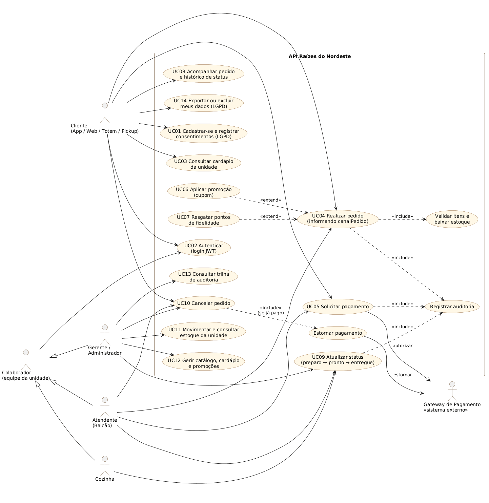
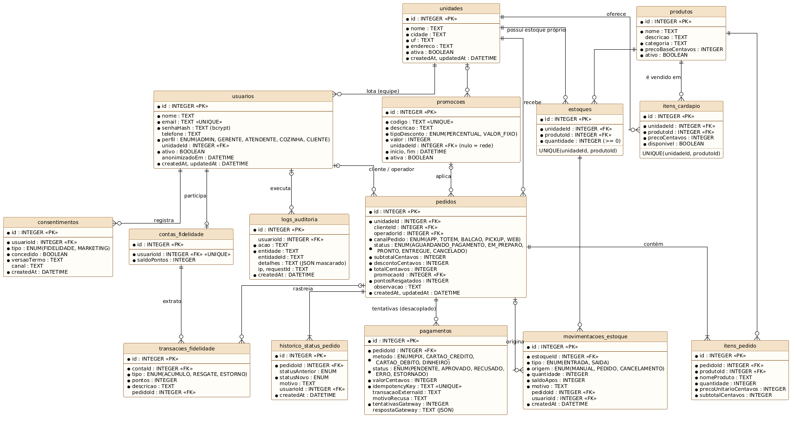
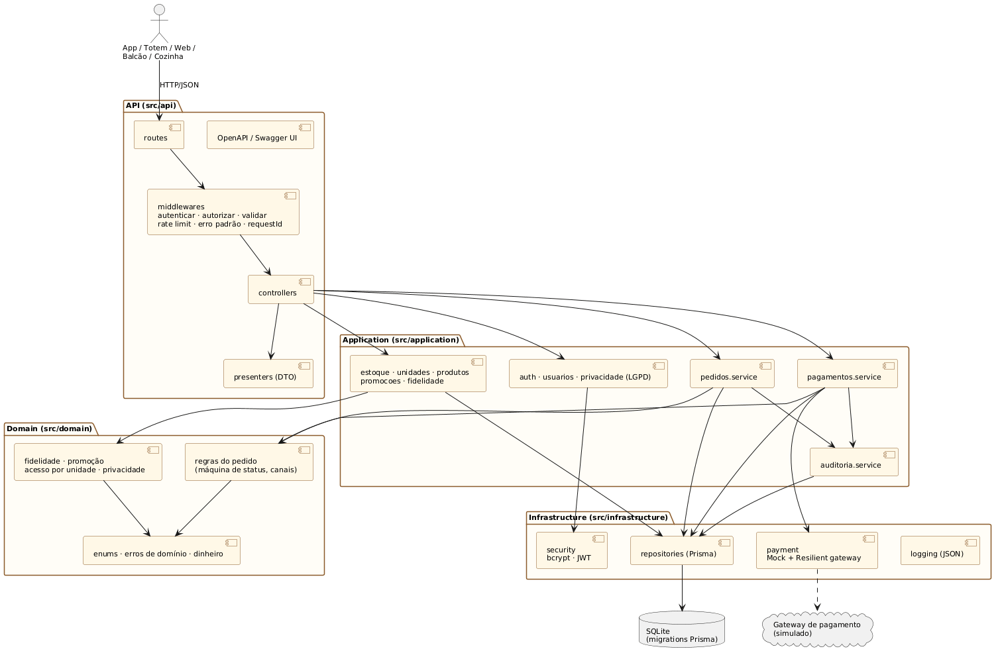
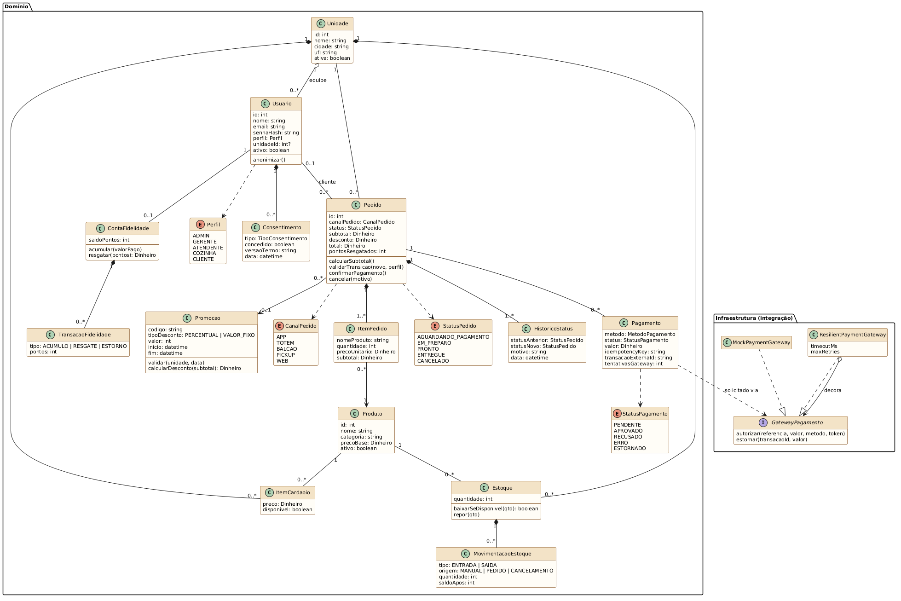
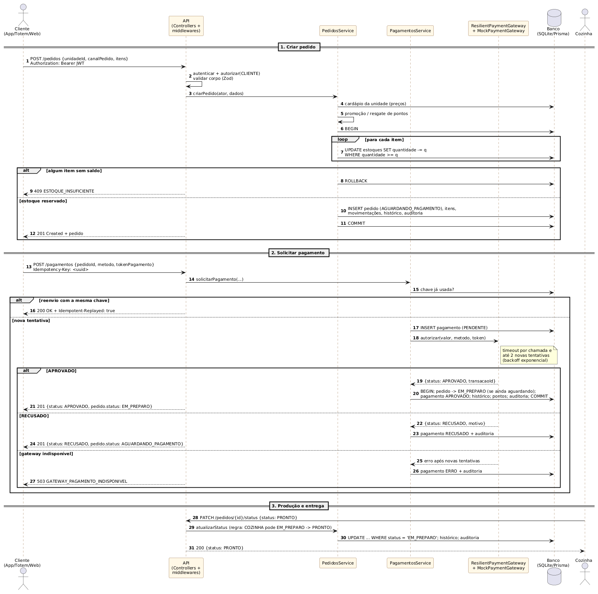
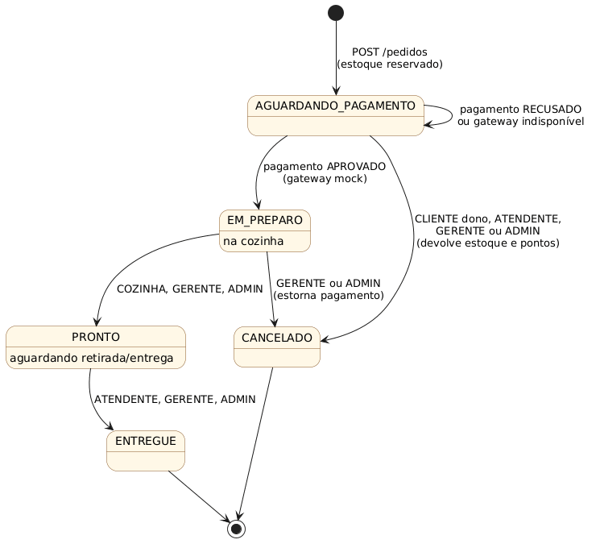

# Modelagem e arquitetura

Os diagramas foram escritos em PlantUML (arquivos `.puml` nesta pasta) e exportados em SVG/PNG.

## Diagrama de casos de uso



Atores: **Cliente** (App/Web/Totem/Pickup), **Atendente** (balcão), **Cozinha**, **Gerente/Administrador** e o
sistema externo **Gateway de Pagamento**. Atendente, Cozinha e Gerente são especializações de *Colaborador*,
que compartilha o caso de uso de autenticação.

### Descrição de feature: UC04 Realizar pedido + UC05 Solicitar pagamento

| Item | Descrição |
|---|---|
| **Objetivo** | Registrar um pedido de qualquer canal, reservar o estoque da unidade, cobrar pelo gateway externo e liberar o pedido para a cozinha. |
| **Ator principal** | Cliente (APP, WEB, TOTEM, PICKUP) ou Atendente (BALCAO). |
| **Atores secundários** | Gateway de pagamento (sistema externo), Cozinha. |
| **Pré-condições** | 1. Usuário autenticado (JWT válido) com perfil CLIENTE, ATENDENTE, GERENTE ou ADMIN. 2. Unidade ativa. 3. Produtos presentes no cardápio da unidade. |
| **Pós-condições (sucesso)** | Pedido gravado com itens, valores e `canalPedido`; estoque baixado; pagamento `APROVADO`; pedido em `EM_PREPARO`; pontos creditados (se houver consentimento); histórico e auditoria registrados. |
| **Pós-condições (falha)** | Nenhuma alteração parcial de estoque (transação desfeita) ou pedido mantido em `AGUARDANDO_PAGAMENTO` com a tentativa de pagamento registrada (`RECUSADO`/`ERRO`). |

**Fluxo principal**

1. O cliente consulta o cardápio da unidade (`GET /unidades/{id}/cardapio`).
2. O cliente envia `POST /pedidos` com `unidadeId`, `canalPedido` e itens (opcionalmente cupom e pontos).
3. O sistema valida o corpo (tipos, campos obrigatórios, `canalPedido` no ENUM) [RN01].
4. O sistema verifica se o canal é permitido ao perfil [RN02] e se a unidade existe e está ativa.
5. O sistema busca os preços **no cardápio da unidade** e calcula subtotal, descontos e total [RN03, RN04, RN05].
6. Em uma única transação, o sistema baixa o estoque de cada item [RN06], grava pedido, itens, movimentações,
   histórico (`AGUARDANDO_PAGAMENTO`) e auditoria; responde **201**.
7. O cliente envia `POST /pagamentos` com `pedidoId`, método e o cabeçalho `Idempotency-Key` [RN07].
8. O sistema registra o pagamento como `PENDENTE` e solicita a autorização ao gateway [RN08].
9. O gateway aprova; o sistema, em transação, marca o pagamento como `APROVADO`, muda o pedido para
   `EM_PREPARO`, credita pontos [RN09] e audita; responde **201** com o status do pedido.
10. A cozinha marca o pedido como `PRONTO` e o atendente como `ENTREGUE` (`PATCH /pedidos/{id}/status`) [RN10].

**Fluxos alternativos e exceções**

| Código | Situação | Resposta |
|---|---|---|
| E1 | Token ausente/inválido | 401 `TOKEN_AUSENTE` / `TOKEN_INVALIDO` |
| E2 | `canalPedido` ausente/inválido, quantidade ≤ 0, lista de itens vazia | 422 `VALIDACAO_FALHOU` |
| E3 | Cliente usando o canal BALCAO | 422 `CANAL_NAO_PERMITIDO` |
| E4 | Unidade ou produto inexistente/fora do cardápio da unidade | 404 `UNIDADE_NAO_ENCONTRADA` / `PRODUTO_NAO_ENCONTRADO` |
| E5 | Estoque insuficiente em qualquer item | 409 `ESTOQUE_INSUFICIENTE` — nada é gravado (rollback) |
| E6 | Cupom expirado/de outra unidade | 422 `PROMOCAO_INVALIDA` |
| E7 | Resgate de pontos sem consentimento ou sem saldo | 422 `CONSENTIMENTO_FIDELIDADE_AUSENTE` / 409 `SALDO_PONTOS_INSUFICIENTE` |
| E8 | **Pagamento negado** pelo gateway | 201 com `status: RECUSADO`, `motivoRecusa`; pedido continua `AGUARDANDO_PAGAMENTO` e pode receber nova tentativa |
| E9 | Gateway fora do ar após novas tentativas | 503 `GATEWAY_PAGAMENTO_INDISPONIVEL`; pagamento fica `ERRO` |
| E10 | Reenvio do mesmo pagamento (mesma `Idempotency-Key`) | 200 com o pagamento original e `Idempotent-Replayed: true` |
| E11 | Pagamento de pedido já pago/cancelado | 409 `PEDIDO_NAO_AGUARDA_PAGAMENTO` |
| E12 | Transição de status não permitida / perfil sem permissão | 409 `TRANSICAO_STATUS_INVALIDA` / 403 `PERFIL_SEM_PERMISSAO` |

**Regras de negócio**

- **RN01** — `canalPedido` é obrigatório e pertence ao ENUM APP, TOTEM, BALCAO, PICKUP, WEB.
- **RN02** — BALCAO é exclusivo da equipe; cliente cria pedidos apenas para si.
- **RN03** — O preço é sempre o do cardápio da unidade no momento da venda (o cliente não envia preço); o nome do produto é copiado para o item (histórico imutável).
- **RN04** — Cupom: válido se ativo, dentro da vigência e da unidade (ou da rede toda). Percentual ou valor fixo, nunca maior que o subtotal.
- **RN05** — Resgate: 10 pontos = R$ 1,00; exige consentimento FIDELIDADE; o desconto não pode superar o valor restante do pedido.
- **RN06** — A baixa de estoque é atômica e condicional; faltando saldo em qualquer item, toda a operação é desfeita.
- **RN07** — Idempotência: a mesma `Idempotency-Key` nunca gera nova cobrança.
- **RN08** — Timeout por chamada ao gateway e até 2 novas tentativas com *backoff* em falhas transitórias; recusas de negócio não são repetidas.
- **RN09** — Acúmulo: 1 ponto por real pago, somente para clientes com consentimento ativo.
- **RN10** — Máquina de status (ver diagrama de estados); `AGUARDANDO_PAGAMENTO → EM_PREPARO` só ocorre pela aprovação do pagamento.
- **RN11** — Cancelamento exige motivo; devolve estoque e pontos; se já pago, estorna no gateway antes de cancelar.

## DER — modelo de dados



O DER é **gerado a partir do mesmo modelo usado pela API** (`prisma/schema.prisma`), e a migration
`prisma/migrations/*_init/migration.sql` cria exatamente estas 14 tabelas no SQLite.

| Tabela | Papel | Restrições relevantes |
|---|---|---|
| `unidades` | Lojas da rede | — |
| `usuarios` | Clientes e equipe | `email` único; `unidadeId` (FK) obrigatório para GERENTE/ATENDENTE/COZINHA (regra na aplicação) |
| `consentimentos` | Prova de consentimento (LGPD) | Registro *append-only*: cada mudança é uma nova linha com versão do termo e data |
| `produtos` | Catálogo central da matriz | Exclusão lógica (`ativo`) para não quebrar pedidos antigos |
| `itens_cardapio` | Preço/disponibilidade por unidade | `UNIQUE(unidadeId, produtoId)` |
| `estoques` | **Estoque próprio de cada unidade** | `UNIQUE(unidadeId, produtoId)`; quantidade nunca negativa (baixa condicional) |
| `movimentacoes_estoque` | Entradas/saídas com saldo após | Origem MANUAL, PEDIDO ou CANCELAMENTO; FK opcional para o pedido |
| `promocoes` | Campanhas por cupom | `codigo` único; `unidadeId` nulo = rede toda |
| `pedidos` | Cabeçalho do pedido | `canalPedido` e `status` ENUM; índices (unidade, status), (canal), (cliente) |
| `itens_pedido` | Itens com preço congelado | Pedido possui 1..N itens |
| `historico_status_pedido` | Rastreabilidade de cada transição | Quem mudou, de/para, motivo e quando |
| `pagamentos` | **Pagamento desacoplado** do pedido | 1 pedido → N tentativas; `idempotencyKey` único; nenhum dado de cartão |
| `contas_fidelidade` / `transacoes_fidelidade` | Saldo e extrato de pontos | Conta única por usuário |
| `logs_auditoria` | Ações sensíveis | Detalhes em JSON já mascarado |

Cardinalidades principais: uma unidade possui muitos itens de cardápio, saldos de estoque e pedidos; um pedido
possui um ou mais itens, um ou mais registros de histórico e zero ou mais tentativas de pagamento; um cliente
possui no máximo uma conta de fidelidade.

## Arquitetura em camadas



```text
src/
├── api/                 # Interface HTTP
│   ├── routes/          #   rotas + autenticação/autorização por rota
│   ├── middlewares/     #   JWT, RBAC, validação Zod, erro padrão, requestId, rate limit
│   ├── controllers/     #   traduzem HTTP <-> casos de uso
│   ├── schemas/         #   contratos de request (Zod)
│   ├── presenters/      #   contratos de response (lista branca de campos)
│   └── docs/openapi.yaml#   documentação Swagger/OpenAPI
├── application/         # Casos de uso (orquestram o fluxo, transações e auditoria)
├── domain/              # Regras puras: máquina de status, canais, fidelidade, promoções, acesso, LGPD
├── infrastructure/      # Detalhes técnicos
│   ├── database/        #   Prisma Client + transação
│   ├── repositories/    #   acesso a dados por agregado
│   ├── payment/         #   gateway mock + decorator de resiliência
│   ├── security/        #   bcrypt e JWT
│   └── logging/         #   log estruturado
├── config/env.js        # Variáveis de ambiente validadas na inicialização
├── app.js / server.js
prisma/                  # schema (DER), migrations e seed
```

Regra de dependência: **API → Application → Domain**; Application usa Infrastructure por meio de
repositórios e do gateway. O domínio não conhece Express nem Prisma, por isso é testado sem banco.

Padrões aplicados:

- **Repository** — cada repositório recebe o cliente do banco (normal ou transacional);
- **Unit of Work** (via `transaction()`) — o caso de uso inteiro é atômico, inclusive a auditoria;
- **Adapter + Decorator** — `MockPaymentGateway` implementa o contrato do gateway e
  `ResilientPaymentGateway` acrescenta timeout e novas tentativas sem alterar o mock;
- **State Machine** — transições de status centralizadas em `domain/pedido.js`;
- **DTO/Presenter** — respostas montadas por lista branca (nunca expõem `senhaHash`);
- **Compare-and-set** — `UPDATE … WHERE status = <esperado>` evita condições de corrida.

## Diagrama de classes (domínio)



## Diagrama de sequência do fluxo crítico



## Diagrama de estados do pedido



## Coerência entre modelagem, regras e endpoints

| Caso de uso | Endpoint(s) | Tabelas | Regras |
|---|---|---|---|
| UC01 Cadastrar-se | `POST /auth/registro` | usuarios, consentimentos, contas_fidelidade | LGPD (consentimento) |
| UC02 Autenticar | `POST /auth/login` | usuarios, logs_auditoria | bcrypt, JWT, auditoria de falha |
| UC03 Consultar cardápio | `GET /unidades/{id}/cardapio` | itens_cardapio, estoques, produtos | disponível = liberado e com saldo |
| UC04 Realizar pedido | `POST /pedidos`, `GET /pedidos` | pedidos, itens_pedido, estoques, movimentacoes_estoque, historico_status_pedido | RN01–RN06 |
| UC05 Solicitar pagamento | `POST /pagamentos`, `GET /pagamentos/{id}` | pagamentos, pedidos, transacoes_fidelidade | RN07–RN09 |
| UC06 / UC07 Promoção e pontos | `codigoPromocao` / `pontosResgatar` em `POST /pedidos` | promocoes, transacoes_fidelidade | RN04, RN05 |
| UC08 Acompanhar pedido | `GET /pedidos/{id}` | pedidos, historico_status_pedido, pagamentos | escopo por perfil |
| UC09 Atualizar status | `PATCH /pedidos/{id}/status` | pedidos, historico_status_pedido | RN10 |
| UC10 Cancelar | `PATCH /pedidos/{id}/status` (`CANCELADO`) | + estoques, pagamentos, transacoes_fidelidade | RN11 |
| UC11 Estoque | `GET /estoque`, `POST/GET /estoque/movimentacoes` | estoques, movimentacoes_estoque | escopo por unidade |
| UC12 Catálogo/promoções | `/produtos`, `PUT /unidades/{id}/cardapio/{produtoId}`, `/promocoes` | produtos, itens_cardapio, promocoes | ADMIN/GERENTE |
| UC13 Auditoria | `GET /auditoria` | logs_auditoria | ADMIN |
| UC14 Direitos LGPD | `GET /usuarios/me/dados`, `PUT /usuarios/me/consentimentos`, `DELETE /usuarios/me` | usuarios, consentimentos | anonimização |
